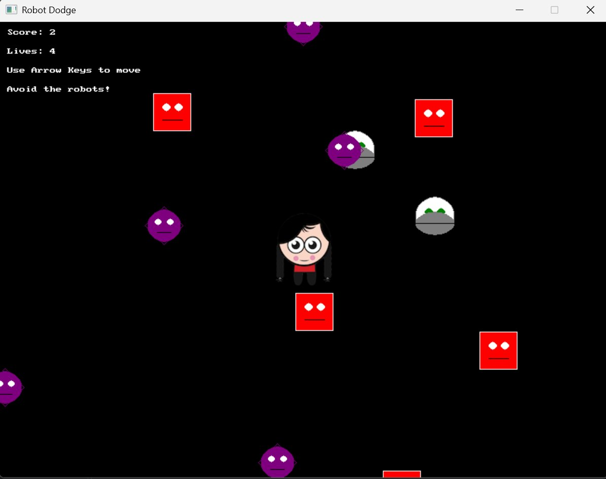

# Spawning Many Different Enemies in SplashKit with Inheritance and Polymorphism

*A SplashKit C# tutorial — building the enemies of a "Robot Dodge" game*

## What you'll build

By the end of this tutorial you will have a game world that continuously
spawns **many enemies of several different kinds** — a boxy robot, a round
robot and a star-shaped robot — each drawn in its own style, each chasing the
player, and all managed by a single list and a single loop. You will see that
adding a brand-new enemy type is one small class, with no change to the game
engine at all.


More importantly, you will see *why* object-oriented design makes this easy.
We will use four ideas from the unit — **abstraction, encapsulation,
inheritance and polymorphism** — not as definitions, but as tools that each
solve a concrete problem the moment it appears.

## Prerequisites

- SplashKit installed for C# (`skm dotnet new console`) and a working
  `dotnet` toolchain.
- A `Player` class exposing `X` / `Y` and a `CollidedWith(Robot)` check. Any
  player from an earlier Robot Dodge task works.
- Comfort with C# classes, fields and methods.

## The problem

A first version of Robot Dodge usually has **one** robot:

```csharp
private Robot _testRobot;
// ...
_testRobot.Update();
_testRobot.Draw();
```

That is fine for one enemy. But a game needs *crowds* of them, appearing over
time, of **different kinds**, each looking different but all behaving like an
enemy. If we write a separate field and separate update/draw code for every
kind, the game loop collapses into a tangle of `if`s. We want the opposite:
**one list, one loop, many types.**

The design that gets us there:

```
          Robot  (abstract)
          ├─ shared: X, Y, Velocity, Update(), CollisionCircle
          └─ abstract Draw()
                 ▲        ▲        ▲
               Boxy    Roundy    Starry
             (each overrides Draw)
```

## Part 1 — An abstract base class: `Robot`

Every robot, whatever its shape, shares the same *state* and the same
*movement*. Only the **drawing** differs. That is the textbook case for an
**abstract base class**: put everything common in the base, and leave a hole
for the part that varies.

```csharp
using SplashKitSDK;
namespace RobotDodge;

public abstract class Robot
{
    private const int SCREEN_WIDTH  = 800;
    private const int SCREEN_HEIGHT = 600;
    private const double ROBOT_SIZE = 50;

    // Encapsulation: anyone can read these, but only a Robot can set them.
    protected Window GameWindow { get; }
    protected Player Player { get; }

    public double X { get; protected set; }
    public double Y { get; protected set; }
    public Vector2D Velocity { get; protected set; }
    public Color MainColor { get; protected set; }

    public int Width  => (int)ROBOT_SIZE;
    public int Height => (int)ROBOT_SIZE;

    public Circle CollisionCircle =>
        SplashKit.CircleAt(X + ROBOT_SIZE / 2, Y + ROBOT_SIZE / 2, ROBOT_SIZE / 2);

    protected Robot(Window gameWindow, Player player)
    {
        GameWindow = gameWindow;
        Player = player;
        MainColor = Color.Red;

        // Start just off one of the four edges, chosen at random.
        int edge = Random.Shared.Next(4);
        switch (edge)
        {
            case 0: X = Random.Shared.Next(0, SCREEN_WIDTH - 50); Y = -ROBOT_SIZE; break;
            case 1: X = SCREEN_WIDTH; Y = Random.Shared.Next(0, SCREEN_HEIGHT - 50); break;
            case 2: X = Random.Shared.Next(0, SCREEN_WIDTH - 50); Y = SCREEN_HEIGHT; break;
            default: X = -ROBOT_SIZE; Y = Random.Shared.Next(0, SCREEN_HEIGHT - 50); break;
        }
    }

    // Shared behaviour: head toward the player. Every robot moves this way.
    public void Update()
    {
        Point2D playerPoint = new Point2D { X = Player.X + 20, Y = Player.Y + 20 };
        Point2D robotPoint  = new Point2D { X = X + ROBOT_SIZE / 2, Y = Y + ROBOT_SIZE / 2 };

        double dx = playerPoint.X - robotPoint.X;
        double dy = playerPoint.Y - robotPoint.Y;
        double distance = Math.Sqrt(dx * dx + dy * dy);

        if (distance > 0.1)
        {
            double speed = 1.5;
            Velocity = new Vector2D { X = dx / distance * speed, Y = dy / distance * speed };
            X += Velocity.X;
            Y += Velocity.Y;
        }
    }

    // The hole: every concrete robot MUST provide its own drawing.
    public abstract void Draw();
}
```

Three things are worth pausing on.

**`abstract class` and `abstract void Draw()`.** Marking the class `abstract`
means you can never write `new Robot(...)` — a "generic robot" is not a real
thing, only specific kinds are. `Draw()` has no body: the base class *declares
that every robot can draw itself* but refuses to say how. That is
**abstraction** — capture the idea of "a robot", defer the detail.

**`protected set` and a `protected` constructor.** `X`, `Y` and `Velocity` can
be *read* by anyone (`public get`) but only *changed* from inside a robot
(`protected set`); the constructor is `protected`, so only a subclass can call
it through `base(...)`. This is **encapsulation**: a robot owns its own
position, and the game loop cannot secretly teleport it.

**Movement by hand.** `Update()` builds a direction from the robot to the
player, divides by the distance to get a unit step, scales it by a `speed`, and
moves. (SplashKit also offers `VectorPointToPoint` and `UnitVector` helpers if
you prefer; the maths here is the same thing, written out.) Because this lives
in the base class, **every** kind of robot chases the player correctly for
free.

## Part 2 — Concrete robots: overriding `Draw()`

Now the shapes. Each is a small class that **inherits** from `Robot`, passes
its arguments up with `: base(...)`, sets its own colour, and **overrides**
`Draw()`.

### Boxy — a square robot

```csharp
public class Boxy : Robot
{
    public Boxy(Window gameWindow, Player player) : base(gameWindow, player)
    {
        MainColor = Color.Red;
    }

    public override void Draw()
    {
        SplashKit.FillRectangle(MainColor, X, Y, Width, Height);
        SplashKit.DrawRectangle(Color.White, X, Y, Width, Height);
        // Eyes
        SplashKit.FillCircle(Color.White, X + 17, Y + 18, 5);
        SplashKit.FillCircle(Color.White, X + 33, Y + 18, 5);
        // Mouth
        SplashKit.DrawLine(Color.Black, X + 12, Y + 35, X + 38, Y + 35);
    }
}
```

### Roundy — a circular robot

```csharp
public class Roundy : Robot
{
    public Roundy(Window gameWindow, Player player) : base(gameWindow, player)
    {
        MainColor = Color.Green;
    }

    public override void Draw()
    {
        double midX = X + 25, midY = Y + 25;
        double leftX = X + 17, rightX = X + 33;
        double eyeY = Y + 20, mouthY = Y + 35;

        SplashKit.FillCircle(Color.White, midX, midY, 25);
        SplashKit.DrawCircle(Color.Gray, midX, midY, 25);
        SplashKit.FillCircle(MainColor, leftX, eyeY, 5);
        SplashKit.FillCircle(MainColor, rightX, eyeY, 5);
        SplashKit.FillEllipse(Color.Gray, X, eyeY, 50, 30);
        SplashKit.DrawLine(Color.Black, X, mouthY, X + 50, Y + 35);
    }
}
```

### Starry — a diamond robot (my custom type)

```csharp
public class Starry : Robot
{
    public Starry(Window gameWindow, Player player) : base(gameWindow, player)
    {
        MainColor = Color.Purple;
    }

    public override void Draw()
    {
        Point2D top    = new Point2D { X = X + 25, Y = Y };
        Point2D right  = new Point2D { X = X + 50, Y = Y + 25 };
        Point2D bottom = new Point2D { X = X + 25, Y = Y + 50 };
        Point2D left   = new Point2D { X = X,      Y = Y + 25 };

        // Diamond outline
        SplashKit.DrawLine(MainColor, top.X, top.Y, right.X, right.Y);
        SplashKit.DrawLine(MainColor, right.X, right.Y, bottom.X, bottom.Y);
        SplashKit.DrawLine(MainColor, bottom.X, bottom.Y, left.X, left.Y);
        SplashKit.DrawLine(MainColor, left.X, left.Y, top.X, top.Y);

        // Face
        SplashKit.FillCircle(MainColor, X + 25, Y + 25, 21);
        SplashKit.FillCircle(Color.White, X + 17, Y + 20, 4);
        SplashKit.FillCircle(Color.White, X + 33, Y + 20, 4);
        SplashKit.DrawLine(Color.Black, X + 16, Y + 34, X + 34, Y + 34);
    }
}
```

Each subclass is tiny. It inherits the position, the velocity, the
chase-the-player `Update()`, the collision circle and the size — and only adds
the one thing that makes it *itself*: how it looks. This is **inheritance**
removing duplication: the shared code is written once, in `Robot`, not three
times.

## Part 3 — Managing the crowd with `List<Robot>`

Here is where **polymorphism** earns its keep. The game holds a single list
typed as the **base class**:

```csharp
private readonly List<Robot> _robots = new List<Robot>();
private const int MAX_ROBOTS = 12;
```

A `List<Robot>` can hold a `Boxy`, a `Roundy` and a `Starry` side by side,
because each of them *is a* `Robot`. The update and draw code never names a
specific type:

```csharp
private void UpdateRobots()
{
    // Move every robot — each runs the shared Update().
    foreach (Robot robot in _robots)
    {
        robot.Update();
    }

    // Occasionally spawn a new one, up to the cap.
    if (_robots.Count < MAX_ROBOTS && SplashKit.Rnd(100) < 2)
    {
        _robots.Add(RandomRobot());
    }

    // Collisions: remove any robot that reaches the player.
    foreach (Robot robot in _robots)
    {
        if (_player.CollidedWith(robot))
        {
            _player.LoseLife();
            _robots.Remove(robot);
            break; // the list just changed — stop iterating this pass
        }
    }
}

private void Draw()
{
    _gameWindow.Clear(Color.White);
    foreach (Robot robot in _robots)
    {
        robot.Draw();   // POLYMORPHISM: the right Draw() runs for each object
    }
    _player.Draw();
    _gameWindow.Refresh(60);
}
```

Look closely at `robot.Draw()` in the draw loop. The compiler only knows
`robot` is *a* `Robot`. But at **runtime**, C# looks at the real object and
calls `Boxy.Draw`, `Roundy.Draw` or `Starry.Draw` accordingly. One line of code
draws every kind of enemy correctly. That is **polymorphism**: one call, many
behaviours, chosen by the actual type.

> **A gotcha worth knowing.** You cannot remove items from a `List<T>` while a
> `foreach` is iterating it — that throws. The `break` above sidesteps it by
> stopping after the first removal. If several robots can be removed in one
> frame, collect them into a second list first, then remove them in a separate
> loop.

## Part 4 — Spawning a random kind (polymorphic creation)

How does a new robot get its type? One small factory method decides at random
and — crucially — **returns the base type**:

```csharp
private Robot RandomRobot()
{
    int choice = SplashKit.Rnd(3);
    if (choice == 0) return new Boxy(_gameWindow, _player);
    if (choice == 1) return new Roundy(_gameWindow, _player);
    return new Starry(_gameWindow, _player);
}
```

The return type is `Robot`, so the rest of the game stays unaware of which kind
it just got. Spawning, updating, drawing and colliding all work through the
base type.

## The real payoff — how `Starry` got added

Here is the test of a good design: **how much do you change to add a feature?**

`Starry` is my own custom robot, and adding it proved the point. To introduce
it I wrote **one new class** — a `Starry : Robot` with its own `Draw()` (above)
— and added **one line** to `RandomRobot` (`SplashKit.Rnd(3)` plus a `return
new Starry(...)`). The game loop, the `List<Robot>`, `UpdateRobots`, `Draw` and
the collision code **did not change at all**.

Want a fourth type? Repeat the recipe:

```csharp
public class Spiky : Robot
{
    public Spiky(Window gameWindow, Player player) : base(gameWindow, player)
    {
        MainColor = Color.Orange;
    }

    public override void Draw()
    {
        SplashKit.FillRectangle(MainColor, X + 10, Y + 10, 30, 30);
        for (int i = 0; i < 50; i += 10)
            SplashKit.FillTriangle(MainColor, X + i, Y + 10, X + i + 10, Y + 10, X + i + 5, Y);
    }
}
```

…and bump `RandomRobot` to `SplashKit.Rnd(4)` with one more branch. New enemy,
no rewrites. That is the whole point of the abstraction.

## Reflection — why this design works

- **Abstraction** let us program against the idea of "a robot" and defer the
  one varying detail (`Draw`) to each type.
- **Encapsulation** kept each robot in charge of its own position, so nothing
  outside can put it into an impossible state.
- **Inheritance** wrote the shared movement, sizing and collision code once.
- **Polymorphism** let a single list and a single loop handle every kind of
  enemy, with runtime dispatch picking the correct `Draw`.

The measure of all four together is that payoff section: a new enemy costs one
small class and one line, with zero changes to the engine. That is what
object-oriented design buys you — software that grows by **adding**, not by
**editing**.

## Where to go next

- Make `Update` `virtual` and override it so a `Starry` can zig-zag while a
  `Boxy` moves straight.
- Add a `Score` that rises as robots leave the screen.
- Raise the spawn chance over time to ramp up difficulty.

---

*Written for SIT771 Object-Oriented Development. All code is C# using
SplashKit, based on my own Robot Dodge game.*
